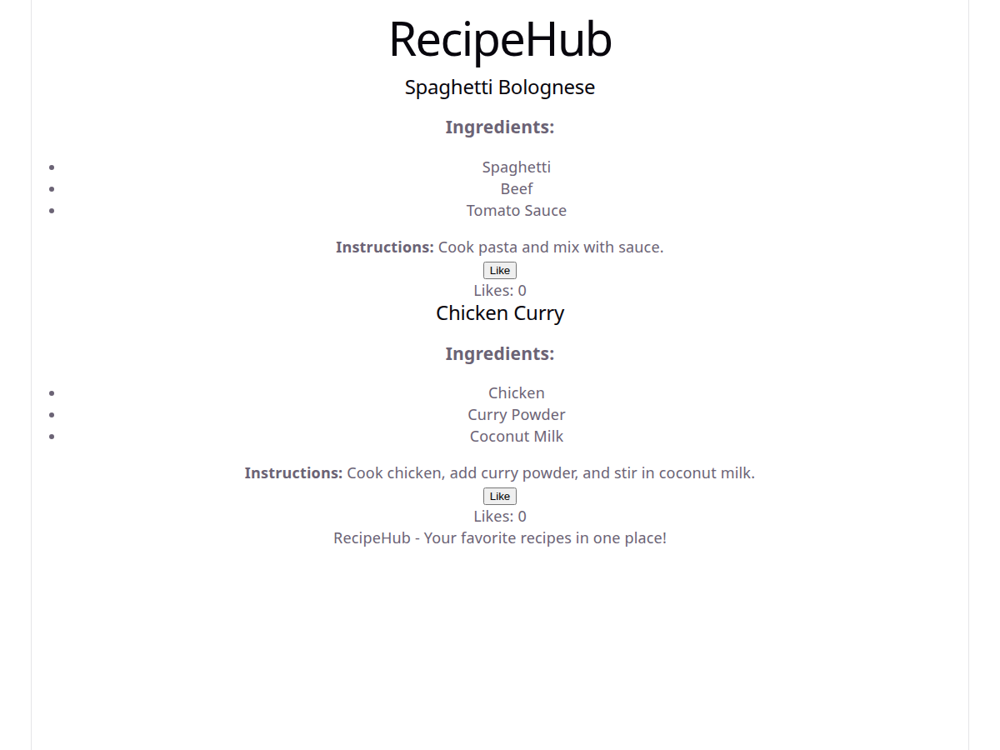
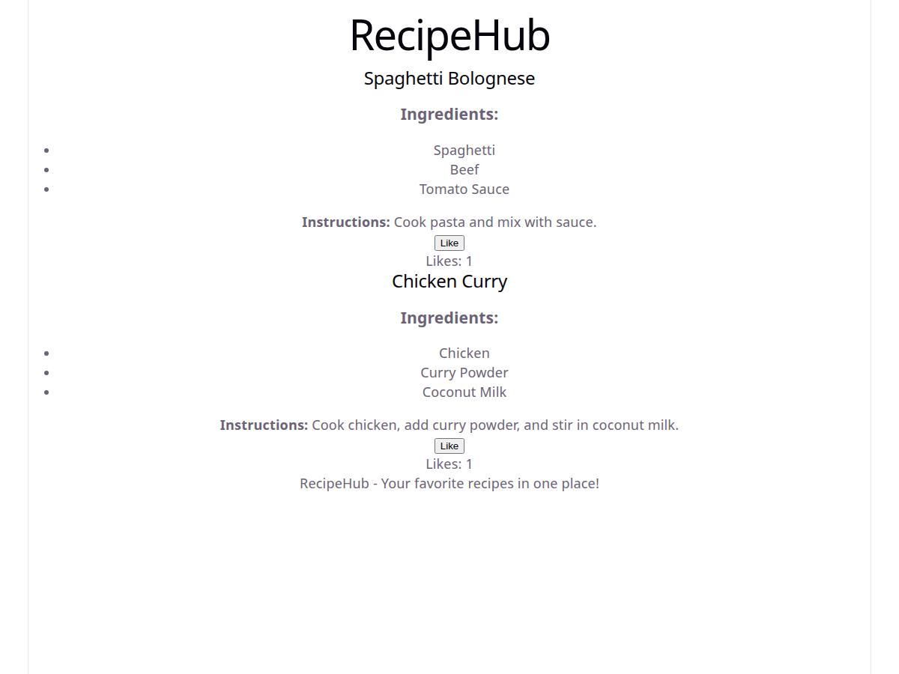

# RecipeHub

RecipeHub is a small React application built with Vite that displays a list of
recipes. Each recipe card shows its title, ingredients, and cooking
instructions, and includes a **Like** button so users can keep track of how
many times they have liked a recipe.

State for the like counter is managed locally inside each `RecipeCard`
component with the `useState` hook, which means every card has its own
independent count.

## Features

- Displays recipes rendered from a data array in `App.jsx`.
- Shows ingredients as a list and the cooking instructions for each recipe.
- Like button that increments a per-recipe likes counter.
- Each recipe card maintains its own state, so liking one recipe does not
  change the count on another card.

## Setup Instructions

1. **Clone the repository and move into the project folder** (skip this step if
   you are already inside the project):

   ```bash
   git clone <repository-url>
   cd recipehub
   ```

2. **Install dependencies:**

   ```bash
   npm install
   ```

3. **Start the development server:**

   ```bash
   npm run dev
   ```

4. Open the URL printed in the terminal (by default
   [http://localhost:5173](http://localhost:5173)).

5. **Build for production** (optional):

   ```bash
   npm run build
   ```

## Screenshots

**Initial state - no likes yet:**



**After clicking the Like button** - the first recipe has 2 likes and the
second recipe has 1 like, demonstrating that each card keeps its own count:



## Code Comments

The components include comments explaining how state works:

- **`src/components/RecipeCard.jsx`**
  - The comment above `useState` explains that `useState` creates a piece of
    local state (`likes`) and a setter (`setLikes`) for updating it, and that
    each card owns its own counter.
  - The comment inside `handleLike` explains that the handler reads the current
    `likes` value, schedules an update with `setLikes`, and that React then
    re-renders the component so the new count appears in the UI.

## Considerations

### Challenges and Common Issues

- **State Initialization:** Make sure state is initialized correctly, for
  example `const [likes, setLikes] = useState(0)`. If the initial value is
  `undefined` or missing, the counter can render as an unexpected value.
- **State Updates:** State must be changed with the setter returned by
  `useState` (for example `setLikes`), never by directly reassigning the
  variable (for example `likes = likes + 1`). Direct mutation does not tell
  React to re-render.
- **Component Re-renders:** React re-renders a component whenever its state
  changes. Calling `setLikes` causes `RecipeCard` to run again and display the
  updated value in real time. Keep in mind that every re-render recalculates
  the component's output, so avoid unnecessary or derived state where possible.
- **Batched Updates:** Multiple `setLikes` calls in the same event can be
  batched. Use the updater form, `setLikes((current) => current + 1)`, when the
  next value depends on the previous one.

## Next Steps

### Add More Features

- Allow users to reset the likes count for a recipe.
- Implement a feature to dislike a recipe (for example, decrement with a
  minimum of zero).
- Persist likes in `localStorage` so they survive a page reload.

### Improve UI

- Apply CSS styles to make the Like button visually appealing.
- Display a total likes count in the `RecipeList` component.
- Add hover and focus styles for better accessibility and feedback.

### Implement Error Handling

- Display a message if there are issues updating state.
- Guard against invalid recipe data (missing ingredients or instructions).

## Tech Stack

- [React](https://react.dev/)
- [Vite](https://vite.dev/)
